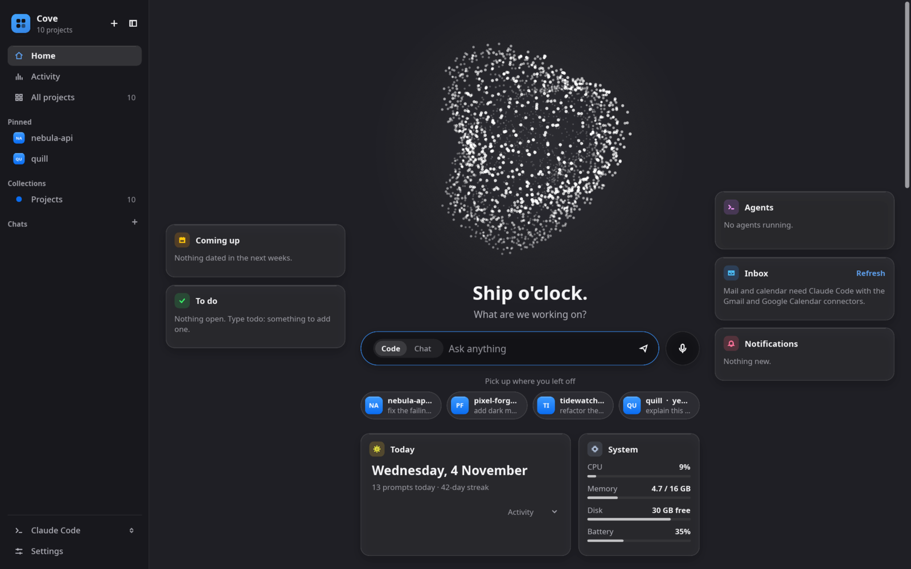

<div align="center">


# Cove

**Every project you code, one click from a coding agent.**

Cove finds the projects on your disk and remembers every Claude Code, Codex and opencode session in them.<br>
It opens any project, new session or old one, in a single click.

[](https://github.com/teslaoruz/cove/releases/latest)
[](https://github.com/teslaoruz/cove/actions/workflows/release.yml)
[](#install)
[](LICENSE)
[](https://slint.dev)

[Install](#install) · [Setup](#setup) · [Features](#features) · [Updates](#updates) · [FAQ](#faq) · [Build from source](#build-from-source)

<br>



</div>

<br>

## Install

One command installs Cove for your user account. You don't need admin or root rights.

**Windows**: open **PowerShell** and run:

```powershell
irm https://github.com/teslaoruz/cove/releases/latest/download/install.ps1 | iex
```

**Linux**: open a terminal and run:

```sh
curl -fsSL https://github.com/teslaoruz/cove/releases/latest/download/install.sh | sh
```

Then start **Cove** from the Start menu or your app menu, or run `cove` in a terminal.

<details>
<summary><b>What the installer does</b></summary>

<br>

1. It downloads the newest release from this repository's [Releases page](https://github.com/teslaoruz/cove/releases).
2. It checks the download against the release's `SHA256SUMS`. If the checksum doesn't match, it stops and installs nothing.
3. It installs Cove for your user only:

| | Windows | Linux |
| --- | --- | --- |
| App | `%LOCALAPPDATA%\Programs\Cove\cove.exe` | `~/.local/bin/cove` |
| Menu entry | Start menu shortcut *Cove* | `~/.local/share/applications/cove.desktop` |
| On `PATH` | Added to your user `PATH` | `~/.local/bin` (most distros include it) |

You can read both scripts before you run them: [`install.ps1`](install.ps1) and [`install.sh`](install.sh).

To install a specific version, set `COVE_VERSION` first. On Linux:

```sh
curl -fsSL https://github.com/teslaoruz/cove/releases/latest/download/install.sh | COVE_VERSION=v0.2.0 sh
```

On Windows, run `$env:COVE_VERSION = 'v0.2.0'` before the install command.

</details>

<details>
<summary><b>Windows: using cmd instead of PowerShell</b></summary>

<br>

```bat
powershell -ExecutionPolicy Bypass -c "irm https://github.com/teslaoruz/cove/releases/latest/download/install.ps1 | iex"
```

</details>

**Requirements**

- 64-bit **Windows 10 or 11**, or 64-bit **Linux** with glibc 2.35 or newer. That covers Ubuntu 22.04+, Debian 12+, Fedora 36+, Arch and openSUSE Tumbleweed.
- At least one coding agent: [Claude Code](https://docs.claude.com/en/docs/claude-code), [Codex](https://github.com/openai/codex) or [opencode](https://opencode.ai). Setup step 1 shows how to install one.

## Setup

Setup takes about two minutes the first time.

### 1. Install a coding agent (skip this if you already have one)

Cove starts your agent for you, so you need at least one installed and signed in. For Claude Code:

| Windows (PowerShell) | Linux |
| --- | --- |
| `irm https://claude.ai/install.ps1 \| iex` | `curl -fsSL https://claude.ai/install.sh \| bash` |

Then run `claude` once in a terminal and sign in. Cove uses that same login. For Codex or opencode, follow their own install guides.

### 2. Install Cove

Run the one-line installer from [Install](#install).

### 3. Tell Cove where your projects live

Open Cove, then open **Settings** (bottom left) and go to **Project folders**.

- Add each folder that holds your projects, for example `C:\Users\you\source\repos` or `~/Projects`.
- Give each folder a **collection** name such as *Work*, *Personal* or *University*. Collections become groups in the sidebar.
- Each folder directly inside a project folder becomes a project card.

On first start, Cove looks for common folders by itself: `~/Projects`, `~/code`, `~/dev`, `~/src`, `~/repos` and `~/source/repos`. If yours is among them, there is nothing to add.

### 4. Pick your tools

Under **Settings → Apps**, choose:

| Setting | What it does |
| --- | --- |
| **Coding agent** | Claude Code, Codex or opencode. You can switch any time from the bottom of the sidebar. |
| **Terminal** | Where sessions open. Windows uses Windows Terminal if you have it, and `cmd` if not. On Linux, Cove finds foot, kitty, Alacritty, WezTerm, Ghostty, Konsole, GNOME Terminal, Ptyxis and xterm. |
| **Code editor** | VS Code, VSCodium, Cursor, Zed, Sublime Text, Neovim or IntelliJ IDEA. |
| **Browser / File manager** | Leave them on *System default*, or pick one. |
| **Updates** | On by default. See [Updates](#updates). |

### 5. Open a project

Click a project and choose:

- **Open** to start a new session in that folder.
- **Continue** to pick up the last session.
- **Sessions** to resume any earlier one.

You can also type a project's name in the box and press Enter.

### Optional extras

- **`git`** shows each project's branch and uncommitted changes.
- **[GitHub CLI](https://cli.github.com)**: run `gh auth login` once, and **Activity** also shows your GitHub contributions.
- **Obsidian vault**: if you keep a note per project, point **Settings → Notes vault** at it. Cove then shows each project's description and open to-dos.

## Features

- **Every project in one place.** Each card shows the session count, when you last worked on the project, and its git state. Pin favourites and hide what you don't need.
- **One-click sessions.** Open a new session, continue the last one, or resume any past session from its first message.
- **Live agents.** See which agents are running right now, in which project, and whether they are working or waiting for you.
- **Ask in plain words.** Type requests such as *"continue nebula-api"*, *"run quill"* or *"new project called atlas"*. Cove opens the right place, with your request already typed.
- **Chat.** Talk to Claude Code without picking a project first. When an idea grows, turn the chat into a project with one click.
- **Activity.** A heatmap, a punch card and charts of your prompts and tokens over time, plus your busiest projects.
- **Quick jumps.** Open any project in your editor, terminal, file manager or on GitHub, or copy its path.
- **Native and light.** One binary written in Rust, with no runtime to install. It opens in under a second and stays quiet in the background.
- **Fits your desktop.** It follows the system light or dark theme and accent colour, and works from the keyboard: <kbd>Ctrl</kbd>+<kbd>K</kbd> to search, <kbd>Ctrl</kbd>+<kbd>B</kbd> for the sidebar, <kbd>Esc</kbd> to go back.

## Updates

Installed copies of Cove keep themselves up to date:

1. Once a day, Cove checks this repository for a newer release.
2. If one exists, Cove runs that release's installer in the background, and the installer verifies the checksum.
3. Cove tells you when the update is ready. The new version starts the next time you open Cove.

To turn this off, switch off **Settings → Apps → Updates**. To update by hand at any time, run the install command again.

Copies you build from source never update themselves.

## Settings and privacy

| | Windows | Linux |
| --- | --- | --- |
| Settings | `%APPDATA%\cove\settings.json` | `~/.config/cove/settings.json` |
| Cache | `%LOCALAPPDATA%\cove\` | `~/.cache/cove/` |

- Cove reads Claude Code's session history from `~/.claude/projects/`, or from `CLAUDE_CONFIG_DIR` if you set it. It never edits or deletes your project sessions. Only Cove's own chats can be renamed or deleted from inside Cove.
- Agents run with your own login. Cove has no account, no telemetry and no server. The only network request it makes itself is the daily update check, which goes to GitHub.

## Uninstall

**Windows** (PowerShell):

```powershell
Remove-Item -Recurse "$env:LOCALAPPDATA\Programs\Cove", "$env:APPDATA\Microsoft\Windows\Start Menu\Programs\Cove.lnk"
```

**Linux**:

```sh
rm ~/.local/bin/cove ~/.local/share/applications/cove.desktop ~/.local/share/icons/hicolor/scalable/apps/cove.svg
```

To also remove your settings, delete the settings folder listed above.

## FAQ

<details>
<summary><b>Windows says "Windows protected your PC".</b></summary>

<br>

Cove isn't code-signed yet, so SmartScreen may warn the first time it runs. Click **More info**, then **Run anyway**. The installer has already checked that the file matches the published release.

</details>

<details>
<summary><b>A project is missing.</b></summary>

<br>

Cove lists the folders directly inside each project folder. Check **Settings → Project folders**, or run `cove --list` in a terminal to see what Cove finds. Projects that you started agents in from somewhere else also appear, under *Other*.

</details>

<details>
<summary><b>"cove" is not found in my terminal.</b></summary>

<br>

- On Windows, open a new terminal so it picks up the updated `PATH`.
- On Linux, add `~/.local/bin` to your `PATH`.

</details>

<details>
<summary><b>Does it work on macOS?</b></summary>

<br>

Not yet. The code has macOS paths in place, but there is no tested build. Contributions are welcome.

</details>

## Known limits

- **Jump to an agent's window** works on the [niri](https://github.com/YaLTeR/niri) compositor. Elsewhere, Cove shows running agents but can't bring their window to the front.
- **Voice** (talk to Cove, spoken replies) has mostly been tested on Linux. Voice input needs [Handy](https://handy.computer) or a local sherpa-onnx model, and stays off without them.
- **Glass** (see-through window) uses Mica on Windows. On Linux, it needs a compositor that blurs, such as KDE Plasma, Hyprland or niri.
- **Windows is newer than Linux.** Each release is built and installed on Windows in CI. If something doesn't feel right, please [open an issue](https://github.com/teslaoruz/cove/issues).

## Build from source

You need [Rust](https://rustup.rs) (stable).

<details>
<summary><b>Linux build libraries</b></summary>

<br>

| Distro | Command |
| --- | --- |
| Debian / Ubuntu | `sudo apt install build-essential pkg-config libasound2-dev libfontconfig1-dev libxkbcommon-dev libwayland-dev` |
| Fedora | `sudo dnf install gcc alsa-lib-devel fontconfig-devel libxkbcommon-devel wayland-devel` |
| Arch | `sudo pacman -S base-devel alsa-lib fontconfig libxkbcommon wayland` |

</details>

On Windows, install Rust with the default MSVC toolchain. Rustup offers to install the Visual Studio Build Tools if they are missing.

```sh
git clone https://github.com/teslaoruz/cove
cd cove/app
cargo build --release
cargo test
```

The app is at `target/release/cove` (`cove.exe` on Windows). On Linux, copy `dist/install.sh`, `dist/cove.desktop` and `../assets/cove.svg` next to the binary, then run `install.sh` to add it to your app menu.

## Contributing

Issues and pull requests are welcome. Every push builds and tests on Linux and Windows through GitHub Actions. A `v*` tag publishes a release, and CI then installs it on clean Linux and Windows machines.

## License

[MIT](LICENSE) © 2026 teslaoruz
